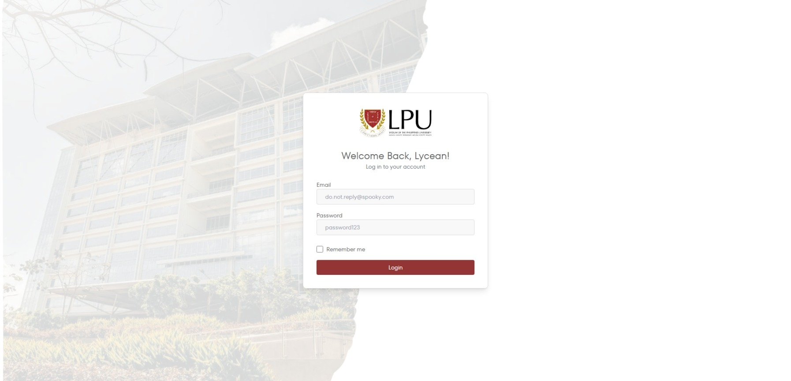
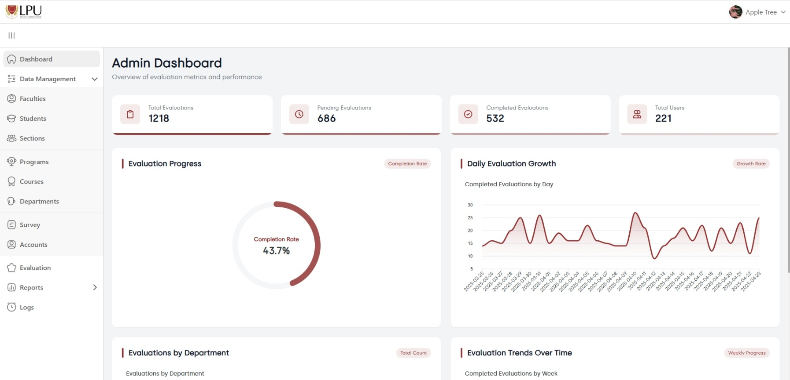
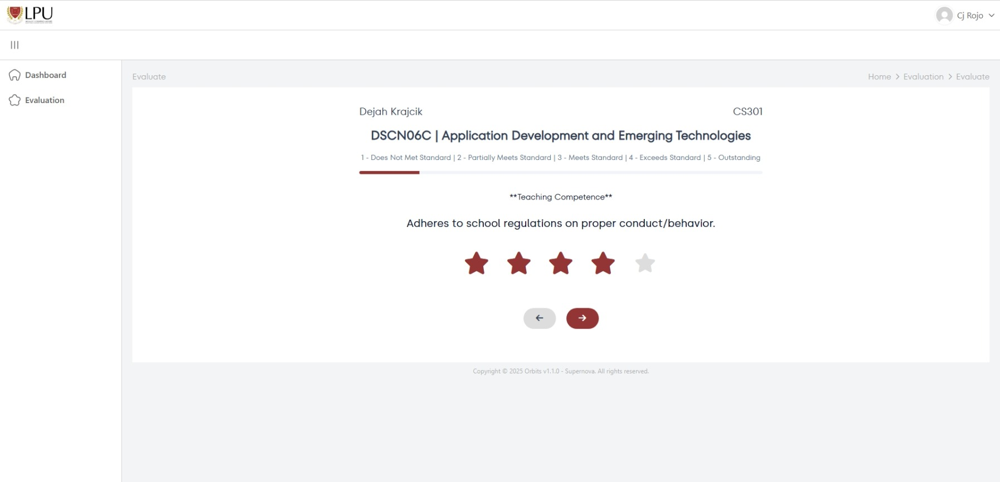
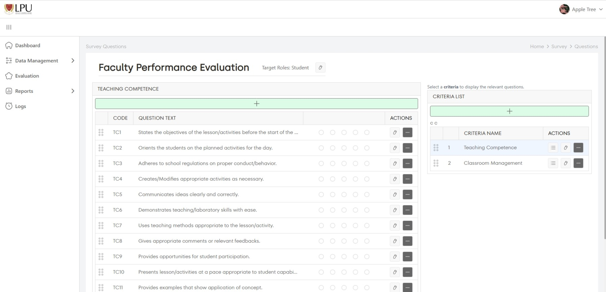
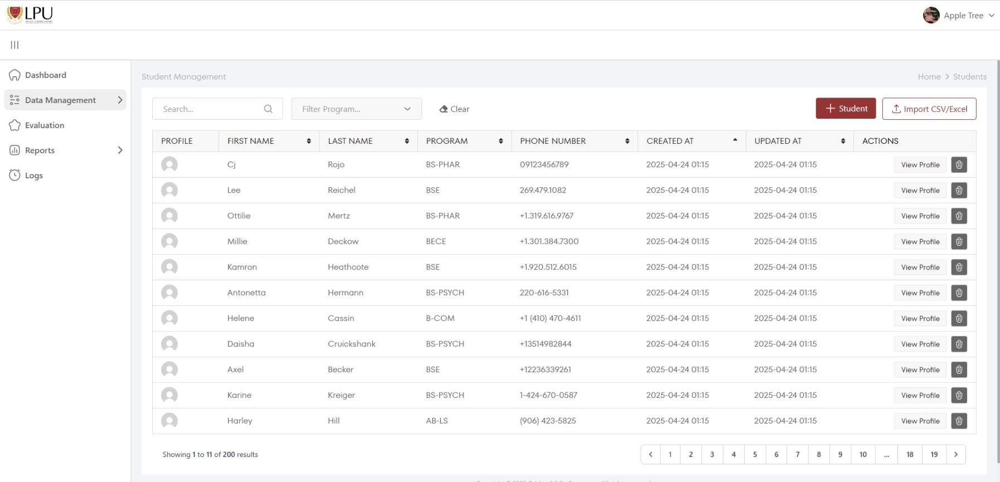
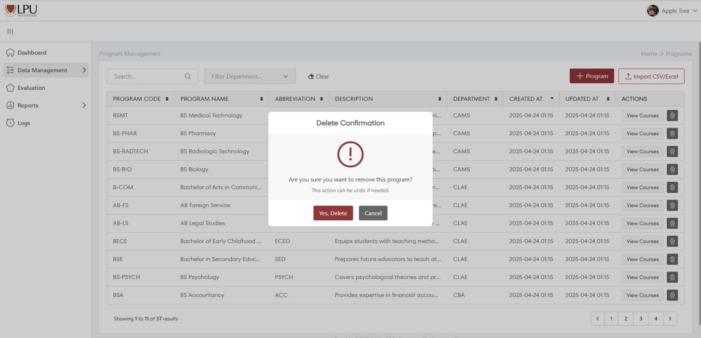
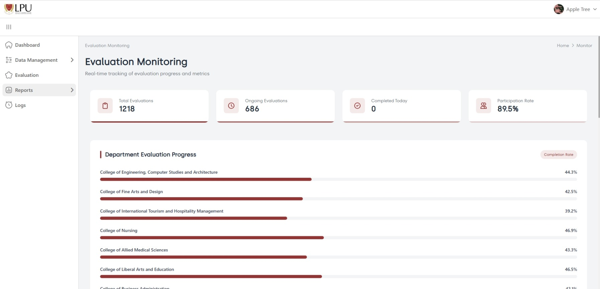
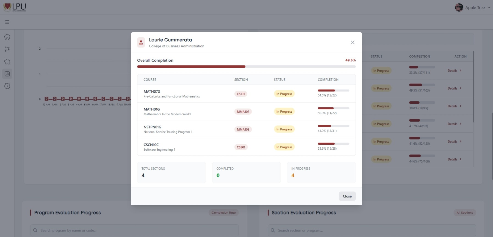
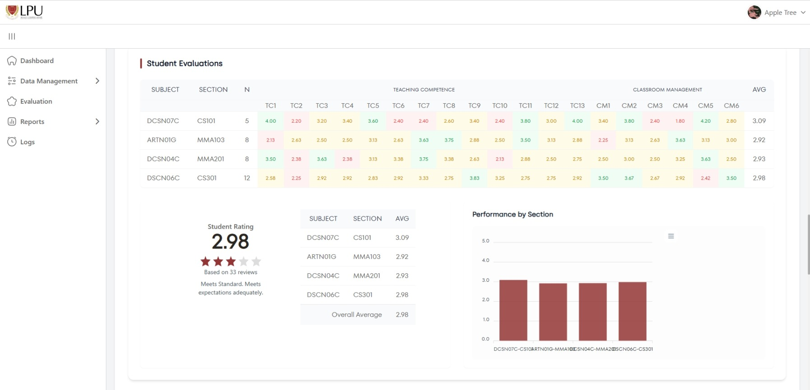

# Orbits

Orbits is a web-based faculty evaluation and academic management system.
Students can evaluate faculty members, while faculty, program chairs, and
administrators can view the information and results relevant to their roles.

The project is built with Laravel, Livewire, MySQL, and a small Flask service
for sentiment analysis of written feedback.



## Features

### Authentication and dashboards

Orbits provides role-based access for students, faculty members, program
chairs, and administrators. Each role receives a dashboard and navigation
options suited to its responsibilities.



### Faculty evaluations

Students can complete assigned faculty evaluations by answering rating
questions and adding written feedback. Administrators can manage surveys and
their questions, while the evaluation workflow records completed submissions.





### Academic management

Administrators can manage departments, courses, programs, sections, faculty,
students, and user accounts. These pages support search, filtering, sorting,
pagination, and common create, edit, and delete actions.





### Results and reporting

Authorized users can view evaluation results, faculty summaries, progress
metrics, and written-feedback sentiment analysis. The system also supports
activity logs, profile management, and profile image uploads.







## User Roles

| Role | Main use |
| --- | --- |
| Student | Complete assigned faculty evaluations |
| Faculty | View relevant evaluation information |
| Program chair | Review program and faculty results |
| Administrator | Manage users, academic data, surveys, and reports |

## Technology

- **Backend:** PHP 8.2+, Laravel 11, Livewire 3
- **Database:** MySQL
- **Frontend:** Blade, Tailwind CSS, Alpine.js, Vite
- **Charts:** ApexCharts
- **Sentiment service:** Python, Flask, Joblib, scikit-learn

## Requirements

Install the following tools:

- PHP 8.2 or newer
- Composer
- Node.js and npm
- MySQL
- Python 3 and pip (only needed for sentiment analysis)

## Installation

### 1. Clone the project

```bash
git clone https://github.com/Moya-Fried-Rice/Orbits_v1.2.git
cd Orbits_v1.2
```

### 2. Install dependencies

```bash
composer install
npm install
```

### 3. Configure the environment

Create the environment file:

```powershell
Copy-Item .env.example .env
php artisan key:generate
```

Set the database values in `.env`:

```dotenv
DB_CONNECTION=mysql
DB_HOST=127.0.0.1
DB_PORT=3306
DB_DATABASE=orbits_v1.2
DB_USERNAME=root
DB_PASSWORD=
```

Create the database in MySQL before continuing.

### 4. Run migrations and seed data

```bash
php artisan migrate --seed
```

To reset the local database and reload all seed data:

```bash
php artisan migrate:fresh --seed
```

### Sample credentials

The development seeders create the following fixed accounts:

| Role | Email | Password |
| --- | --- | --- |
| Administrator | `appleadmin@gmail.com` | `admin123` |
| Student | `student.demo@orbits.local` | `StudentDemo!2026` |

Generated faculty, program chair, and additional student accounts use Faker
email addresses. Their seeded passwords are `faculty123`, `chair123`, and
`student123`, respectively.

These are development-only credentials. Change or remove them before using the
application outside local development.

### 5. Link storage

```bash
php artisan storage:link
```

## Running the Application

The easiest way to start the Laravel server, queue listener, and Vite is:

```bash
composer run dev
```

The application is usually available at:

```text
http://127.0.0.1:8000
```

To run the processes separately:

```bash
php artisan serve
php artisan queue:listen --tries=1
npm run dev
```

For a production frontend build:

```bash
npm run build
```
